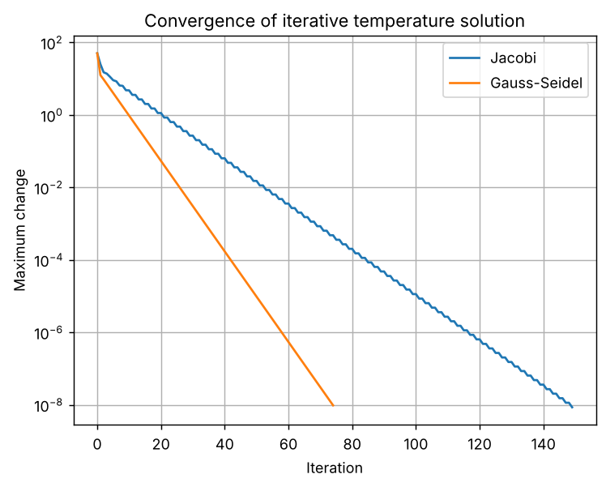
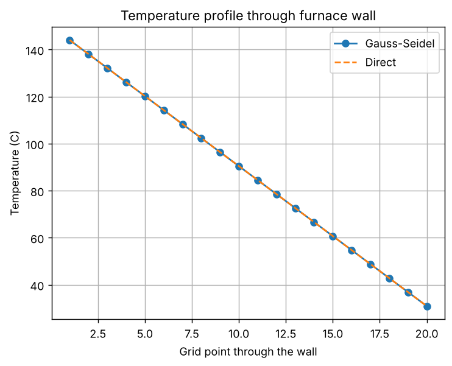
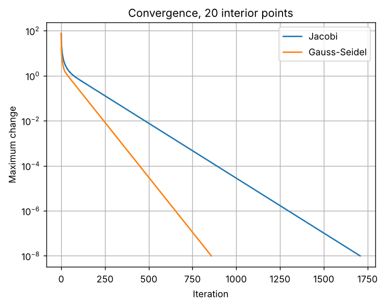

# Task 8: Iterative Methods for Linear Systems

**Concept:** Jacobi and Gauss-Seidel start from a guess and refine it until successive estimates differ by less than a tolerance. They suit large sparse systems.

**Files:** `code/Task_08_iterative_linear.py` (original) and `modified/Task_08_modified_furnace_wall.py` (modified cases)

## 1. Original program

**Input values:** A 5x5 tridiagonal matrix (2 on the diagonal, -1 beside it), boundary vector b = [100, 0, 0, 0, 20] and tolerance 1e-8.

**Mathematical operations:** Jacobi and Gauss-Seidel iterations, a direct solution for comparison, and a semi-log plot of the change per iteration.

**Output**

```text
Jacobi temperatures: [86.66666665 73.33333331 59.99999997 46.66666664 33.33333332]
Gauss-Seidel temperatures: [86.66666665 73.3333333  59.99999997 46.66666665 33.33333332]
Direct solution: [86.66666667 73.33333333 60.         46.66666667 33.33333333]
Jacobi iterations: 150
Gauss-Seidel iterations: 75
```



**Meaning of the output:** Jacobi needs 150 iterations and Gauss-Seidel 75. Both agree with the direct answer (86.67, 73.33, 60.00, 46.67, 33.33) to about 1e-8: temperature falls linearly from 100 C on the left to 20 C on the right. On the semi-log graph both curves are straight lines, meaning the error shrinks by a constant factor per iteration, and the Gauss-Seidel line is steeper, so it converges about twice as fast.

## 2. Parameter change

**What was changed:** Changed the boundary temperatures (80 C and 30 C) and the tolerance (1e-3 instead of 1e-8).

**How the result changes and why:** New boundary values do not change the iteration counts (150 and 75), because the convergence rate depends on the matrix, not on b. A looser tolerance of 1e-3 cuts the counts to 70 and 35, but the true error rises to 2.9e-3: the stopping test measures the change between iterations, not the actual error.

## 3. New real-world case: Temperature profile through a furnace wall

**Assumptions:** Steady one-dimensional conduction through a wall divided into n interior points, with 150 C on the furnace side and 25 C outside. The grid size is varied to see how cost scales.

**Input data:** Tridiagonal matrix of size 10, 20 and 40, boundary vector with 150 and 25, tolerance 1e-6 (1e-8 for the plotted case).

**Output of `modified/Task_08_modified_furnace_wall.py`** (Part A is the parameter change, Part B is the new case)

```text
PART A - original 5-point grid, changed boundaries/tolerance
left=100, right=20, tol=1e-08: Jacobi 150 its, Gauss-Seidel 75 its, max error vs exact 2.89e-08
left=80, right=30, tol=1e-08: Jacobi 150 its, Gauss-Seidel 75 its, max error vs exact 2.84e-08
left=100, right=20, tol=1e-03: Jacobi 70 its, Gauss-Seidel 35 its, max error vs exact 2.87e-03

PART B - furnace wall (150 C inside, 25 C outside)
n=10 interior points: Jacobi   385 its, Gauss-Seidel   194 its
n=20 interior points: Jacobi  1299 its, Gauss-Seidel   654 its
n=40 interior points: Jacobi  4506 its, Gauss-Seidel  2273 its
n=20 maximum difference Gauss-Seidel vs direct: 4.34e-07 C
Temperature at first, middle and last interior points: [144.05  90.48  30.95]
```





**Interpretation:** Iteration counts grow rapidly with grid size: Jacobi needs 385, 1299 and 4506 iterations and Gauss-Seidel 194, 654 and 2273 for n = 10, 20, 40. Doubling n multiplies the work by about 3.5, which is why very fine grids need faster methods. For n = 20 the temperature drops linearly from 144.05 C (first point) through 90.48 C (middle) to 30.95 C (last), matching the direct solution to 4e-7 C. This is the expected linear profile for steady conduction through a uniform wall.
