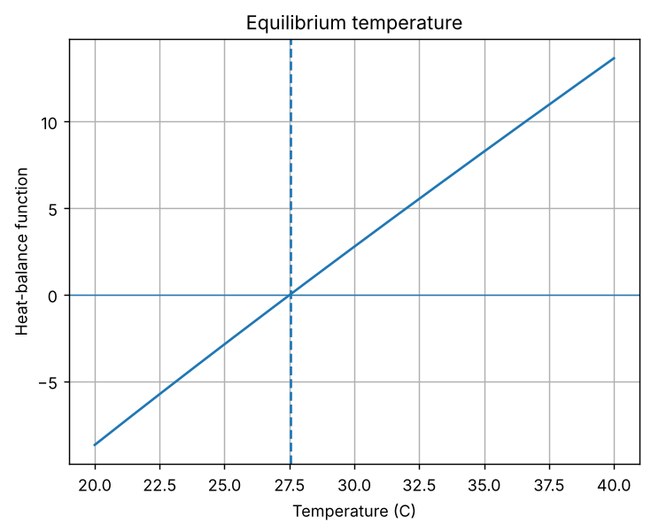
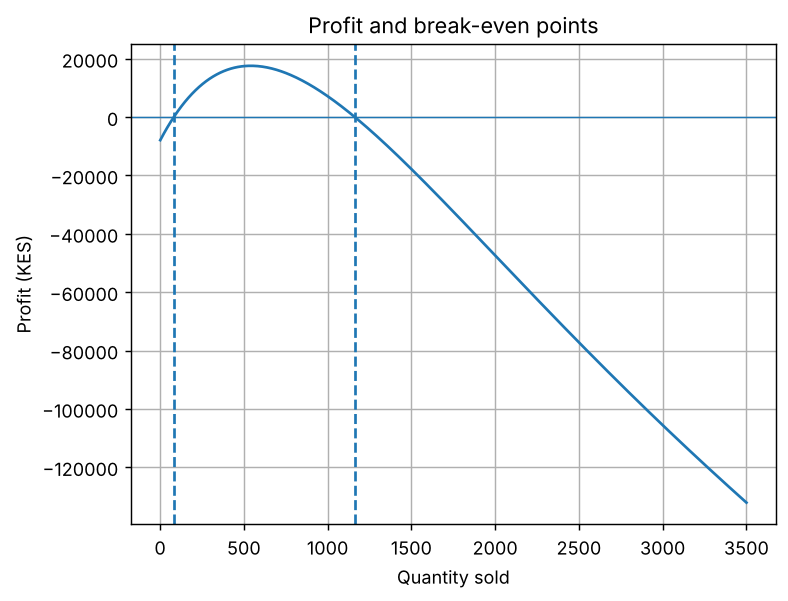

# Task 10: Root Finding: Bisection and Fixed-Point Methods

**Concept:** Bisection halves a bracketing interval that contains a sign change; fixed-point iteration repeats x = g(x). Bisection always converges, fixed-point is faster but needs |g'(x)| < 1.

**Files:** `code/Task_10_bisection_fixed_point.py` (original) and `modified/Task_10_modified_break_even.py` (modified cases)

## 1. Original program

**Input values:** The heat-balance function f(T) = T - 25 - 10 exp(-T/20), bracket [20, 40], tolerance 1e-10, and a starting temperature of 30 C for the fixed-point form.

**Mathematical operations:** root_scalar with method bisect, and the iteration T = 25 + 10 exp(-T/20).

**Output**

```text
Bisection equilibrium temperature: 27.525211 C
Bisection iterations: 38
Fixed-point equilibrium temperature: 27.525211 C
Fixed-point iterations: 13
```



**Meaning of the output:** Both methods find the equilibrium temperature 27.525211 C. Bisection needs 38 iterations and fixed-point only 13. In the graph the function rises through zero at 27.53 C, where heat gain equals heat loss: below it the system gains heat, above it the system loses heat.

## 2. Parameter change

**What was changed:** Changed the heat-gain coefficient from 10 to 15 and the fixed-point starting value from 30 to 38.

**How the result changes and why:** With the coefficient 15 the equilibrium moves up to 28.591212 C, because more heat input needs a higher temperature to balance. Starting at 38 C still converges to 27.525211 C (14 iterations), because |g'(T)| is about 0.13 near the root, well below 1. Bisection uses 38 iterations in every case because the count depends only on the bracket width and tolerance.

## 3. New real-world case: Break-even quantities with a falling price

**Assumptions:** The price drops as more units are sold: price(q) = 150 exp(-q/1000) KES. Fixed cost is 8000 KES and variable cost is 40 KES per unit. Profit(q) = q price(q) - (8000 + 40 q).

**Input data:** Brackets [10, 150] for the lower break-even and [500, 3000] for the upper one; start 200 for the fixed-point form q = (8000 + 40 q) / price factor.

**Output of `modified/Task_10_modified_break_even.py`** (Part A is the parameter change, Part B is the new case)

```text
PART A - heat balance f(T) = T - 25 - c*exp(-T/20)
c=10, start=30.0: bisection 27.525211 C (38 its), fixed-point 27.525211 C (13 its)
c=15, start=30.0: bisection 28.591212 C (38 its), fixed-point 28.591212 C (15 its)
c=10, start=38.0: bisection 27.525211 C (38 its), fixed-point 27.525211 C (14 its)

PART B - break-even analysis
Lower break-even quantity (bisection): 81.41 units (34 its)
Lower break-even quantity (fixed point from 200): 81.41 units (25 its)
Upper break-even quantity (bisection): 1163.08 units
Profitable range: 81 to 1163 units
Quantity that maximises profit (marginal revenue = marginal cost): 541.6 units, profit 17603 KES
```



**Interpretation:** Profit is zero at 81.41 units (bisection 34 iterations, fixed-point 25 iterations, same answer) and again at 1163.08 units. The business is profitable only between about 81 and 1163 units sold, with a maximum profit of 17,603 KES near 541.6 units. The graph is a hump: losses at low volume (fixed costs) and again at very high volume (price collapse).
