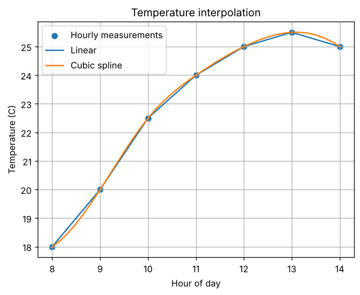
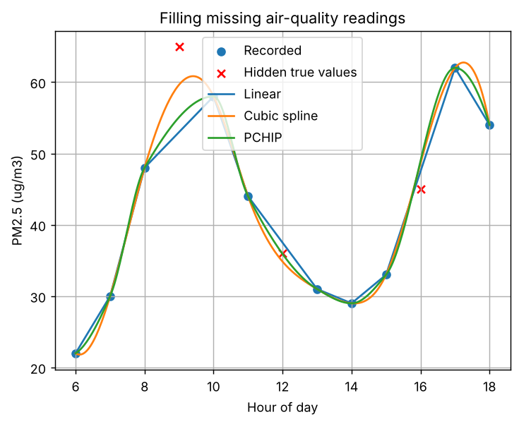

# Task 13: Interpolation

**Concept:** Interpolation estimates values between measured points. Linear interpolation joins points with straight lines; cubic splines give a smooth curve.

**Files:** `code/Task_13_interpolation.py` (original) and `modified/Task_13_modified_missing_pm25.py` (modified cases)

## 1. Original program

**Input values:** Hourly temperatures from 08:00 to 14:00 (18.0 to 25.5 C).

**Mathematical operations:** interp1d (linear) and CubicSpline, evaluated every 10 minutes and at 10:30.

**Output**

```text
Linear estimate at 10:30: 23.25 C
Cubic estimate at 10:30: 23.36 C
```



**Meaning of the output:** At 10:30 the linear estimate is 23.25 C and the cubic estimate is 23.36 C. The graph shows the linear estimate as straight segments with corners at each hour, while the spline is a smooth curve through the same points, which is more realistic for temperature.

## 2. Parameter change

**What was changed:** Evaluated at other times (08:30, 12:30, 13:45) and also at 15:00, outside the data range.

**How the result changes and why:** The two methods differ by 0.09 to 0.19 C, with the largest gap at 08:30 where the data curves most. At 15:00 interp1d raises a ValueError: interpolation only works inside the measured range, and extrapolating needs a separate, riskier decision.

## 3. New real-world case: Recovering missing PM2.5 air-quality readings

**Assumptions:** Hourly PM2.5 (micrograms per cubic metre) from 06:00 to 18:00 with illustrative values. To test the methods, the readings at 09:00 (65), 12:00 (36) and 16:00 (45) are hidden and estimated from the others.

**Input data:** 13 hourly values, with 10 used for fitting and 3 hidden for testing.

**Output of `modified/Task_13_modified_missing_pm25.py`** (Part A is the parameter change, Part B is the new case)

```text
PART A - original temperature data, different query times
t=8.5: linear 19.000 C, cubic 18.809 C, difference 0.191
t=10.5: linear 23.250 C, cubic 23.363 C, difference 0.113
t=12.5: linear 25.250 C, cubic 25.340 C, difference 0.090
t=13.75: linear 25.125 C, cubic 25.250 C, difference 0.125
t=15.0 (outside 8-14): ValueError - interpolation does not extrapolate by default

PART B - recovering hidden PM2.5 values
True hidden values: [65. 36. 45.]
Linear       : estimates [53.  37.5 47.5], RMSE 7.13
Cubic spline : estimates [59.6 34.8 48.6], RMSE 3.80
PCHIP        : estimates [55.1 35.9 49. ], RMSE 6.17
```



**Interpretation:** Linear estimates are (53.0, 37.5, 47.5) with RMSE 7.13; cubic spline gives (59.6, 34.8, 48.6) with RMSE 3.80; PCHIP gives (55.1, 35.9, 49.0) with RMSE 6.17. The cubic spline is best here, but every method underestimates the sharp 09:00 peak, since interpolation cannot recreate a peak it never saw. Only three test points were used, so the ranking is indicative, not definitive.
