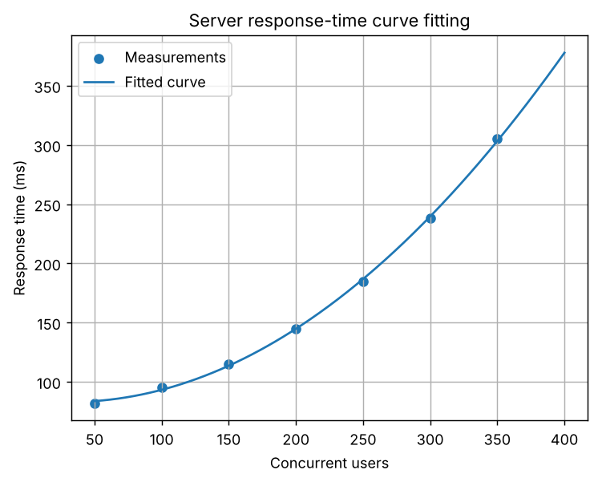
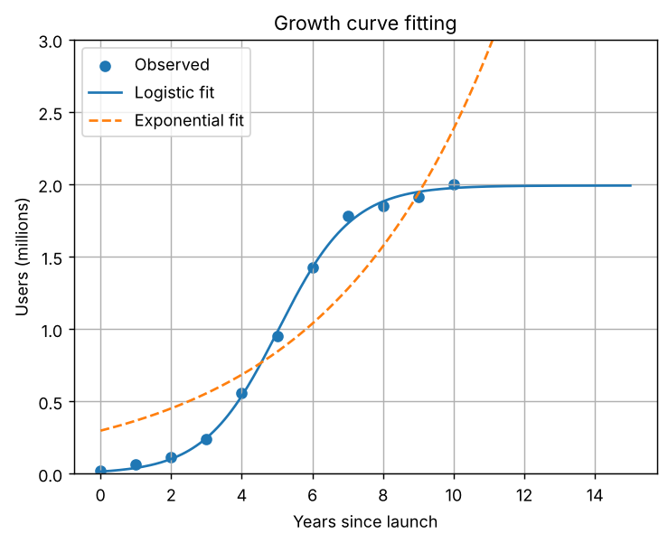

# Task 14: Curve Fitting and Approximation

**Concept:** Curve fitting chooses model parameters that minimise the sum of squared residuals between data and model.

**Files:** `code/Task_14_curve_fitting.py` (original) and `modified/Task_14_modified_growth_curve.py` (modified cases)

## 1. Original program

**Input values:** Seven (users, response time) measurements from 50 to 350 users and a quadratic model a x squared + b x + c.

**Mathematical operations:** curve_fit, RMSE, and prediction at 400 users, with a plot of data and fitted curve.

**Output**

```text
Fitted model: y = 0.002167x^2 + -0.1345x + 85.00
RMSE: 1.55 ms
Predicted response at 400 users: 377.86 ms
```



**Meaning of the output:** The fit is y = 0.002167 x squared - 0.1345 x + 85.00 with RMSE 1.55 ms, so the model passes close to every point. It predicts 377.86 ms at 400 users. The positive x squared term means response time grows faster as load rises, which the plotted curve shows.

## 2. Parameter change

**What was changed:** Changed the model degree: linear (1), quadratic (2) and cubic (3).

**How the result changes and why:** RMSE is 18.83 ms for a line (underfitting, because the data curves), 1.55 ms for the quadratic and 0.14 ms for the cubic. The prediction at 400 users moves from 312.9 to 377.9 to 387.9 ms. More parameters always fit the existing data better, but with only seven points the cubic risks overfitting and its extrapolation is the least trustworthy.

## 3. New real-world case: Logistic growth of a mobile app's user base

**Assumptions:** The data are synthetic: generated from a logistic curve (limit 2 million, rate 0.9 per year, midpoint at year 5) plus noise (standard deviation 0.05 million, seed 7). They stand in for yearly user counts.

**Input data:** Years 0 to 10 and observed users in millions. Models: logistic L / (1 + exp(-k(t - t0))) and exponential a exp(b t).

**Output of `modified/Task_14_modified_growth_curve.py`** (Part A is the parameter change, Part B is the new case)

```text
PART A - polynomial degree on server data
degree 1: RMSE 18.83 ms, prediction at 400 users 312.9 ms
degree 2: RMSE 1.55 ms, prediction at 400 users 377.9 ms
degree 3: RMSE 0.14 ms, prediction at 400 users 387.9 ms
A higher degree always lowers training error, but extrapolation can become unreliable.

PART B - logistic growth
Logistic fit: L=1.992 (+/-0.023) million, k=0.959, midpoint=5.04 years
RMSE logistic 0.027 vs exponential 0.307 (million users)
Forecast year 15: logistic 1.99 M, exponential 6.7 M
```



**Interpretation:** The logistic fit recovers L = 1.992 (+/- 0.023) million, k = 0.959 and midpoint 5.04 years, with RMSE 0.027, against 0.307 for the exponential. At year 15 the logistic forecast is 1.99 million users (saturation) but the exponential predicts 6.7 million, an unrealistic result. A good model should match the real process, not just the data points.
