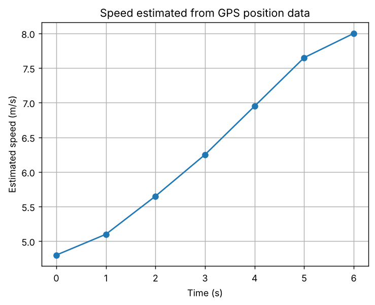
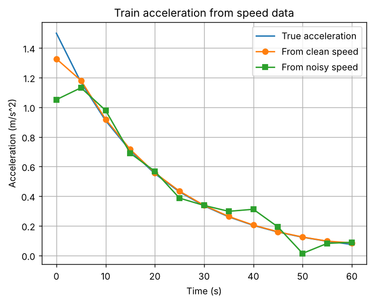

# Task 15: Numerical Differentiation

**Concept:** A derivative can be estimated from nearby values: forward differences use the next point, central differences use points on both sides and are more accurate.

**Files:** `code/Task_15_numerical_differentiation.py` (original) and `modified/Task_15_modified_acceleration.py` (modified cases)

## 1. Original program

**Input values:** Seven GPS samples: time 0 to 6 s and position 0 to 38 m.

**Mathematical operations:** Forward difference at the start, central differences inside, backward difference at the end.

**Output**

```text
t=0s, position=0.0m, estimated speed=4.80m/s
t=1s, position=4.8m, estimated speed=5.10m/s
t=2s, position=10.2m, estimated speed=5.65m/s
t=3s, position=16.1m, estimated speed=6.25m/s
t=4s, position=22.7m, estimated speed=6.95m/s
t=5s, position=30.0m, estimated speed=7.65m/s
t=6s, position=38.0m, estimated speed=8.00m/s
```



**Meaning of the output:** Estimated speed rises from 4.80 m/s to 8.00 m/s, so the vehicle is accelerating; the graph is an upward line. The two end values use one-sided differences and are less accurate than the interior ones.

## 2. Parameter change

**What was changed:** Tested the step size h on sin(x) at x = 1, where the exact derivative is cos(1).

**How the result changes and why:** At h = 0.1 the forward error is 4.3e-2 and the central error 9.0e-4. Dividing h by 10 divides the forward error by 10 but the central error by 100 (first-order versus second-order accuracy). The central error is best near h = 1e-5 (1.1e-11); at h = 1e-12 it rises again to 1.2e-5 because subtracting nearly equal numbers amplifies round-off.

## 3. New real-world case: Train acceleration from speed measurements

**Assumptions:** Train speed v(t) = 30 (1 - exp(-t/20)) m/s is sampled every 5 s for 60 s. A second copy has Gaussian sensor noise with standard deviation 0.3 m/s (seed 3). The true acceleration is 1.5 exp(-t/20).

**Input data:** 13 time values and clean and noisy speeds; np.gradient gives the derivative.

**Output of `modified/Task_15_modified_acceleration.py`** (Part A is the parameter change, Part B is the new case)

```text
PART A - error versus step size h
       h |  forward error |  central error
   1e-01 |      4.294e-02 |      9.001e-04
   1e-02 |      4.216e-03 |      9.005e-06
   1e-03 |      4.208e-04 |      9.005e-08
   1e-05 |      4.207e-06 |      1.114e-11
   1e-08 |      2.970e-09 |      2.581e-09
   1e-12 |      4.324e-05 |      1.227e-05
Error falls with h (truncation) until h is so small that round-off dominates.

PART B - acceleration from speed
Mean absolute error, clean data : 0.0180 m/s^2
Mean absolute error, noisy data : 0.0733 m/s^2
Acceleration at t=0: true 1.500, estimated (clean) 1.327, (noisy) 1.051 m/s^2
```



**Interpretation:** The mean absolute error is 0.0180 m/s squared for clean data and 0.0733 m/s squared for noisy data, four times larger: differentiation amplifies noise. At t = 0 the true acceleration is 1.500, the clean estimate 1.327 (one-sided difference over a coarse 5 s step) and the noisy estimate 1.051. Practical systems smooth the data or use finer sampling before differentiating.
