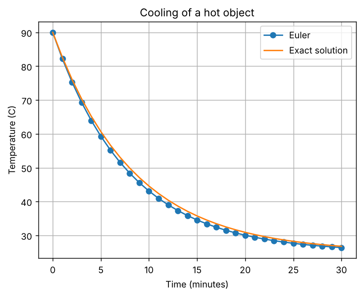
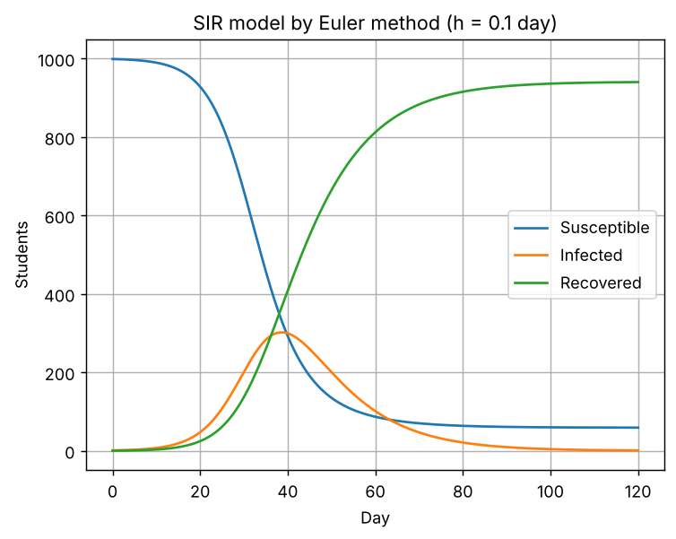

# Task 17: Ordinary Differential Equations - Euler Method

**Concept:** Euler's method steps an ODE forward: y(next) = y + h f(t, y). A smaller step size gives more accuracy and more computation.

**Files:** `code/Task_17_euler_ode.py` (original) and `modified/Task_17_modified_sir_euler.py` (modified cases)

## 1. Original program

**Input values:** Newton's cooling law dT/dt = -k (T - 25) with k = 0.12 per minute, starting at 90 C, step h = 1 minute, 30 minutes.

**Mathematical operations:** Repeated Euler updates, compared with the exact solution 25 + 65 exp(-k t).

**Output**

```text
Euler temperature after 30 min: 26.40 C
Exact temperature after 30 min: 26.78 C
Final absolute error: 0.3720 C
```



**Meaning of the output:** After 30 minutes Euler gives 26.40 C and the exact answer is 26.78 C, an error of 0.372 C. In the graph the Euler points run slightly below the exact curve, and the temperature decays toward the 25 C room temperature, fast at first and then slowly.

## 2. Parameter change

**What was changed:** Changed h to 0.5 and 0.1, and tried a larger k with a large step (k = 0.5, h = 5).

**How the result changes and why:** The error falls from 0.372 C to 0.189 C and then 0.038 C: it is proportional to h. With k = 0.5 and h = 5 the product h k is 2.5, which exceeds 2, so every step multiplies the deviation by -1.5 and the result explodes to 765 C while the exact answer is 25 C. Euler is unstable if the step is too large.

## 3. New real-world case: SIR epidemic in a school of 1,000 students

**Assumptions:** Closed population N = 1000 with one initial infection; infection rate beta = 0.3 per day, recovery rate gamma = 0.1 per day, so R0 = 3. No vaccination, even mixing, 120 days. dS/dt = -beta S I / N, dI/dt = beta S I / N - gamma I, dR/dt = gamma I.

**Input data:** Step sizes h = 1, 0.1 and 0.01 days.

**Output of `modified/Task_17_modified_sir_euler.py`** (Part A is the parameter change, Part B is the new case)

```text
PART A - Euler error for cooling
h=1.0, k=0.12: Euler 26.4041 C, exact 26.7760 C, error 0.3720 C
h=0.5, k=0.12: Euler 26.5870 C, exact 26.7760 C, error 0.1890 C
h=0.1, k=0.12: Euler 26.7378 C, exact 26.7760 C, error 0.0383 C
h=1.0, k=0.5: Euler 25.0000 C, exact 25.0000 C, error 0.0000 C
h=5.0, k=0.5: Euler 765.3906 C, exact 25.0000 C, error 740.3906 C
Note h=5, k=0.5 gives h*k=2.5 (> 2): each step multiplies the error by (1-h*k) = -1.5, so Euler is unstable.

PART B - SIR epidemic
Basic reproduction number R0 = beta/gamma = 3.0
h=1.0: peak infected 312.7 on day 41.0, total ever infected 947 (94.7%)
h=0.1: peak infected 302.0 on day 38.6, total ever infected 941 (94.1%)
h=0.01: peak infected 300.9 on day 38.4, total ever infected 940 (94.0%)
```



**Interpretation:** The infection peaks at about 300 students around day 38, and about 94% of students are eventually infected. Using h = 1 overestimates the peak (312.7) and delays it to day 41; h = 0.1 and 0.01 agree closely (302.0 and 300.9). The graph shows susceptibles falling, infections rising then falling, and recoveries climbing to roughly 940. These numbers belong to the model's assumptions; they are not a forecast for a real school.
