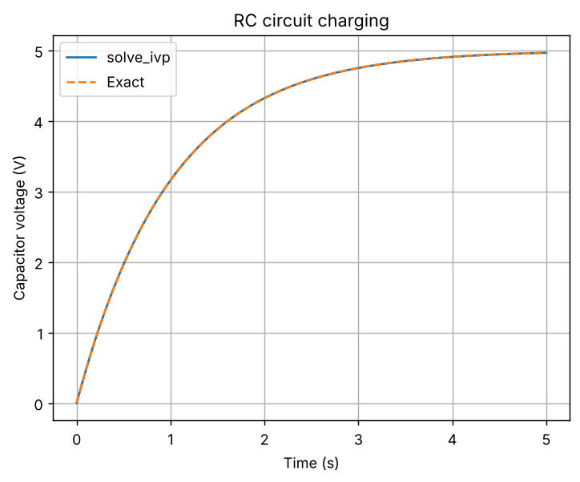
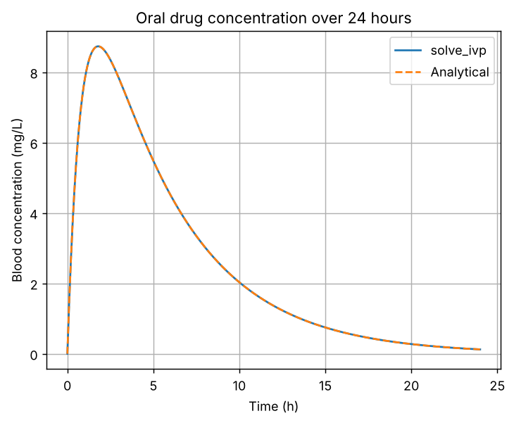

# Task 18: Numerical Solution of ODEs Using SciPy

**Concept:** solve_ivp uses adaptive higher-order methods, so you supply f(t, y), initial values and a time interval instead of coding each step.

**Files:** `code/Task_18_scipy_ode.py` (original) and `modified/Task_18_modified_drug_concentration.py` (modified cases)

## 1. Original program

**Input values:** Supply voltage 5 V, R = 1000 ohms, C = 0.001 F, initial voltage 0 V, time 0 to 5 s.

**Mathematical operations:** solve_ivp for dV/dt = (Vs - V)/(RC), compared against the exact charging curve.

**Output**

```text
Solver success: True
Capacitor voltage at 5 s: 4.9663 V
Maximum error against exact solution: 9.282e-10 V
```



**Meaning of the output:** The capacitor reaches 4.9663 V after 5 s, which is 99.3% of 5 V because 5 seconds equals five time constants (RC = 1 s). The maximum difference from the exact curve is 9.3e-10 V, so the solver is extremely accurate. In the graph the solver and the exact curve overlap and the voltage saturates at 5 V.

## 2. Parameter change

**What was changed:** Changed R to 2000 ohms and C to 0.0002 F.

**How the result changes and why:** Doubling R doubles the time constant to 2 s: after 1 s the voltage is 1.967 V instead of 3.161 V. Reducing C to 0.0002 F gives a time constant of 0.2 s, so the capacitor is almost fully charged (4.966 V) after 1 s. The final voltage is always 5 V; only the speed changes.

## 3. New real-world case: Drug concentration after an oral dose

**Assumptions:** A single 500 mg dose, one-compartment model with first-order absorption from the gut (ka = 1.2 per hour) and elimination (ke = 0.2 per hour), volume of distribution 40 L, 100% absorbed. Parameters are illustrative and not medical advice.

**Input data:** Initial gut amount 500 mg, blood concentration 0, time 0 to 24 h.

**Output of `modified/Task_18_modified_drug_concentration.py`** (Part A is the parameter change, Part B is the new case)

```text
PART A - RC circuit, voltage after 1 second
R=1000, C=0.001: tau=1.0000 s, V(1 s)=3.1606 V, V(5 s)=4.9663 V
R=2000, C=0.001: tau=2.0000 s, V(1 s)=1.9673 V, V(5 s)=4.5896 V
R=1000, C=0.0002: tau=0.2000 s, V(1 s)=4.9663 V, V(5 s)=5.0000 V

PART B - drug concentration
Peak concentration: 8.735 mg/L at 1.80 h (analytic tmax = 1.79 h)
Concentration at 12 h: 1.361 mg/L; at 24 h: 0.123 mg/L
Maximum difference from analytical solution: 1.07e-09 mg/L
Elimination half-life: 3.47 h
```



**Interpretation:** The concentration peaks at 8.735 mg/L about 1.8 hours after the dose (theory gives 1.79 h), then falls to 1.361 mg/L at 12 h and 0.123 mg/L at 24 h. The elimination half-life is 3.47 h. The numerical result matches the analytical formula to 1e-9 mg/L. The graph shows a quick rise as the drug is absorbed, followed by slower exponential decline.
