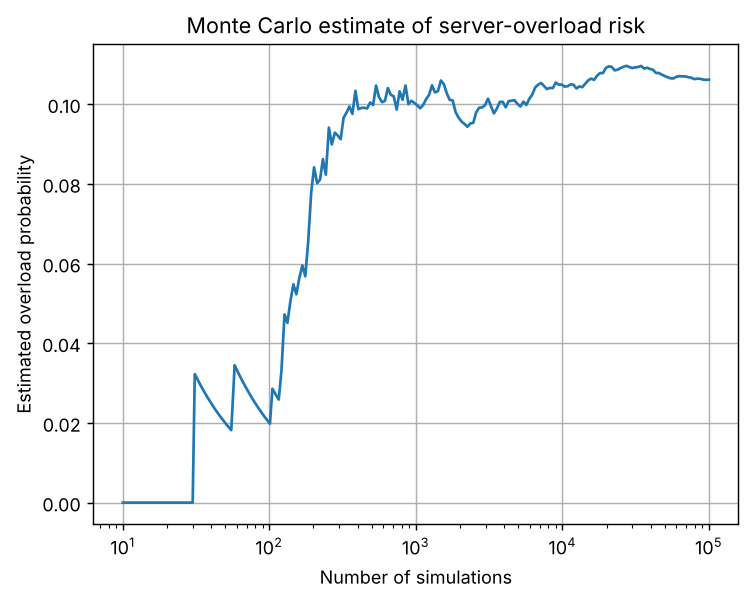
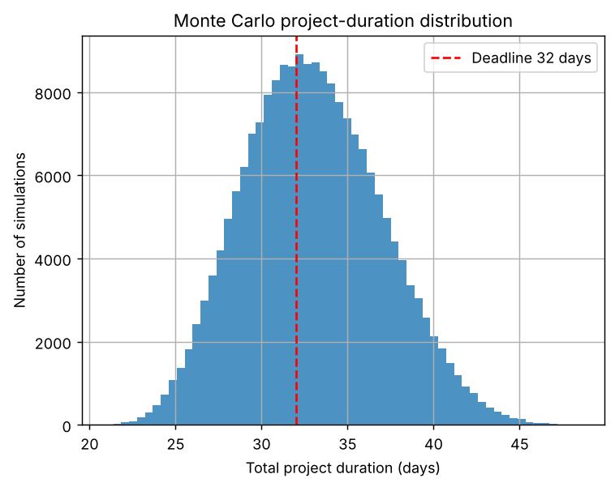

# Task 20: Random Numbers and Monte Carlo Methods

**Concept:** Monte Carlo methods estimate a probability by simulating many random scenarios and counting how often the event happens.

**Files:** `code/Task_20_monte_carlo.py` (original) and `modified/Task_20_modified_project_risk.py` (modified cases)

## 1. Original program

**Input values:** Server capacity 1000, demand normally distributed with mean 850 and standard deviation 120, N = 100,000 scenarios, seed 42.

**Mathematical operations:** Generate demand, flag demand above capacity, take the mean of the flags, and plot the running estimate.

**Output**

```text
Estimated overload probability: 10.6160%
Number of overload cases: 10616 out of 100000
```



**Meaning of the output:** The estimated overload probability is 10.616% (10,616 of 100,000 cases). The exact normal-distribution value is 10.57%, so the simulation is close. In the graph the running estimate swings widely for the first few hundred runs and then settles near 0.106, illustrating that more simulations give a more stable estimate.

## 2. Parameter change

**What was changed:** Changed N to 1,000, the random seed to 7, and the standard deviation to 180.

**How the result changes and why:** With N = 1000 the estimate is 10.10% with a standard error near 0.95%; with N = 100,000 it is 10.62% (seed 42) or 10.56% (seed 7), with a standard error near 0.10%. Error shrinks like 1/sqrt(N). Raising the standard deviation to 180 doubles the risk to 20.22%, as more demand variability means more frequent overloads. A bonus estimate of pi from 200,000 points gives 3.1464.

## 3. New real-world case: Probability that a software project finishes on time

**Assumptions:** Three sequential tasks have triangular duration distributions (min, most likely, max) in days: design (5, 8, 14), build (10, 15, 25), test (4, 6, 12). The deadline is 32 days. 200,000 simulations, seed 42.

**Input data:** Three random duration arrays whose sum is the total project time.

**Output of `modified/Task_20_modified_project_risk.py`** (Part A is the parameter change, Part B is the new case)

```text
PART A - overload probability (capacity 1000, mean 850)
Exact value for std=120 from the normal distribution: 10.57%
N=  1,000, std=120, seed=42: p=10.1000%  (standard error 0.953%)
N=100,000, std=120, seed=42: p=10.6160%  (standard error 0.097%)
N=100,000, std=120, seed=7: p=10.5580%  (standard error 0.097%)
N=100,000, std=180, seed=42: p=20.2210%  (standard error 0.127%)
Bonus - pi estimate from 200,000 points: 3.1464

PART B - project schedule risk
Most-likely plan (sum of modes): 29 days
Mean total: 32.99 days, std: 4.01 days
P(finish within 32 days) = 42.18% +/- 0.22% (95% interval)
80th percentile: 36.4 days, 95th percentile: 39.9 days
```



**Interpretation:** Adding the most likely durations gives 29 days, but the simulated mean is 32.99 days because each distribution skews to longer times. The chance of finishing within 32 days is only 42.18% (+/- 0.22%). The 80th percentile is 36.4 days and the 95th is 39.9 days. A manager should plan with a buffer of about a week rather than trust the 29-day figure. The histogram shows a bell-like total with a deadline line cutting off less than half the area.
